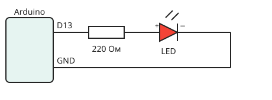

# Светодиод и резистор

**Светодиод** — полупроводниковый прибор, который светится, когда через него течёт ток в прямом направлении.

## Как устроен светодиод

У светодиода две ножки:

- **анод** (+) — длинная ножка;
- **катод** (−) — короткая ножка, со стороны катода на корпусе есть срез.

!!! warning "Полярность важна"
    Если перепутать ножки, светодиод не загорится. При небольшом напряжении он не сломается, но и работать не будет.

## Зачем нужен резистор

Светодиод почти не сопротивляется току. Если подключить его напрямую к питанию, ток будет слишком большим, и светодиод перегорит. **Резистор** ограничивает ток.

<figure markdown>
  { .schema width="460" }
  <figcaption>Схема подключения светодиода к пину 13</figcaption>
</figure>

## Расчёт резистора

Сопротивление считаем по закону Ома:

$$
R = \frac{U_{пит} - U_{LED}}{I}
$$

где:

- $U_{пит}$ — напряжение питания (у Arduino 5 В);
- $U_{LED}$ — падение напряжения на светодиоде (у красного около 2 В);
- $I$ — рабочий ток светодиода (обычно 20 мА = 0,02 А).

!!! example "Пример"
    $R = \dfrac{5 - 2}{0{,}02} = 150$ Ом.

    Берём ближайший **больший** номинал из стандартного ряда, на практике чаще всего 220 Ом.

## Проверь себя

??? question "Что будет, если взять резистор 10 кОм?"
    Светодиод загорится, но очень тускло: ток будет всего около 0,3 мА.

??? question "Какую ножку светодиода подключают к GND?"
    Короткую — катод.
